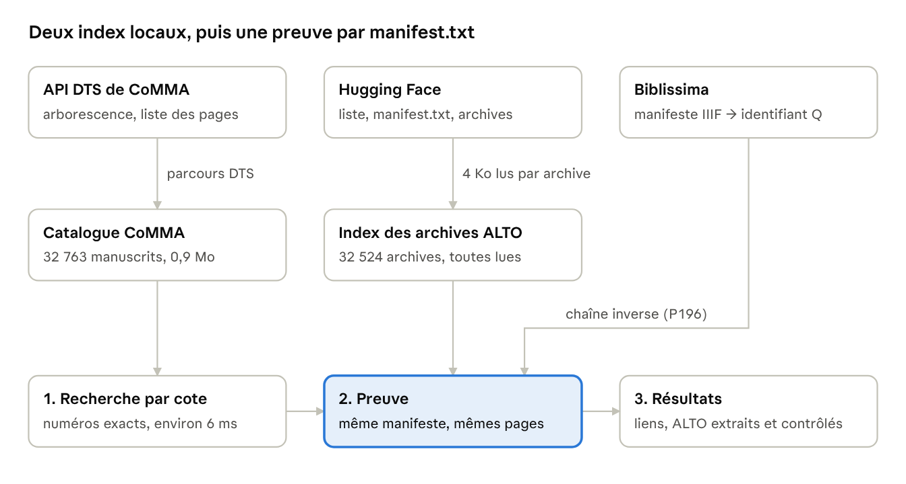

# CoMMA-Search — shelfmark search in CoMMA and ALTO retrieval

*[Version française](README.md)*

CoMMA-Search finds a manuscript of the [CoMMA](https://comma.inria.fr/catalog) corpus (Inria) from its shelfmark in a few milliseconds, without going through the website's search, then links its transcription to its ALTO files on Hugging Face, **proving** the match through each archive's `manifest.txt`. It relies on two local indexes, shipped ready-made and kept up to date by the application: the CoMMA catalogue (32,763 manuscripts) and the ALTO archive index (32,524 archives, all read).



Both indexes are built once and shipped with the tool; at each search, it only re-reads live the first line of the `manifest.txt` of the archives found, and the list of CoMMA pages.

## Installing and running

### Executables (no Python needed)

Ready-to-use executables are attached to each release (**Releases** tab): `CoMMA-Search-windows.zip`, `CoMMA-Search-macos.zip` (Apple Silicon Macs), `CoMMA-Search-linux.tar.gz`. Unpack and run `CoMMA-Search`.

They are not signed:

- **Windows**: if SmartScreen says "Windows protected your PC", click *More info*, then *Run anyway*.
- **macOS**: the first time, right-click (or Ctrl-click) `CoMMA-Search.app`, then *Open*.

### With Python

Python 3.8 or later, with Tkinter (bundled with Python on Windows and macOS, and with Anaconda/Spyder; on Linux: package `python3-tk`). No other library is needed.

| Use | Command |
| --- | --- |
| Spyder | open `CoMMAsearch.py`, press **F5** |
| Terminal | `python CoMMAsearch.py` |
| Prefilled search | `python CoMMAsearch.py --recherche "Troyes 816"` |
| No GUI | `python CoMMAsearch.py --cli "Troyes, BM, 816"` (add `--telecharger` to download and extract the confirmed archive) |
| Language | `--lang fr` or `--lang en` (otherwise the saved setting, then the system language) |

Keep `CoMMAsearch.py`, `comma_core.py`, `comma_i18n.py` and the `donnees/` folder together.

## Overview

The tool queries three public sources, with no account or key:

| Source | What the tool takes from it | Endpoint |
| --- | --- | --- |
| CoMMA, TexTile DTS API | the catalogue tree, the list of pages of each manuscript | `comma.inria.fr/api/collection/`, `/api/navigation/` |
| Hugging Face, `comma-project/alto-dataset` repository | the list of archives, the start of their `manifest.txt`, the download | `huggingface.co/api/datasets/…/tree/main`, `…/resolve/main/` |
| Biblissima (Wikibase) | the reverse chain IIIF manifest → Q identifier | `data.biblissima.fr/w/api.php` |

Repository files:

| File | Role |
| --- | --- |
| `CoMMAsearch.py` | Tkinter interface (run with F5 in Spyder) and text mode (`--cli`) |
| `comma_core.py` | all the logic: indexes, search, matching, download |
| `comma_i18n.py` | French / English translations |
| `donnees/catalogue_comma.json.gz` (0.9 MB) | shipped CoMMA catalogue |
| `donnees/index_alto.json.gz` (0.8 MB) | shipped ALTO archive index |
| `tests/test_comma_core.py` | 25 offline tests: `python -m unittest discover -s tests` |
| `packaging/comma_search.spec` | building the executables (PyInstaller) |
| `.github/workflows/` | `Tests` (Windows, macOS, Linux) and `Binaries` (executables) |

Only the Python standard library is used (urllib, gzip, zlib, tarfile, tkinter): nothing to install, on Windows, macOS and Linux.

## Index 1: the local CoMMA catalogue

The local catalogue holds the 32,763 manuscripts published by CoMMA, exactly the total reported by `/api/manuscripts/count/`; it was built on 15 Nov 2026 in 3 min 43 s. The tool does not use the website's full-text search: it is fuzzy ("Troyes 816" does not return ms. 816 there, "Latin 16400" first returns 16408 and 16401) and its `manifest_url` field can be wrong.

**Building it.** The tool walks the public tree of the DTS API, page by page:

1. the `mega-corpus` root lists 227 cities;
2. each city lists its institutions (405 in all);
3. each institution lists its manuscripts, 20 per page (`/api/collection/?id=<id>&nav=children&page=<n>`); the last page is read from the `view.last` link.

That is about 2,300 requests, six at a time. A collection attached to two parents is read only once; an error or closing the window stops the whole walk within moments, and the previous catalogue is kept.

**Content of each record** (all from the manuscript's DTS resource):

| Field | Origin | Example (Troyes 816) |
| --- | --- | --- |
| identifier | the resource's `@id`, which is the Biblissima URI | `https://data.biblissima.fr/entity/Q412957` |
| title | `title` | Troyes. Médiathèque du Grand Troyes, Ms. 816 |
| IIIF manifest | `dublinCore.source` | `https://api.irht.cnrs.fr/ark:/63955/f9a5a7k98nwu/manifest.json` |
| date, language | `dublinCore.created`, `.language` | 1201/1400 · lat |
| size | `dublinCore.extent` | Tokens: 358200, Acceptable OCRed lines: 47108 (90.8%) |
| city, institution | titles of the parent collections | Troyes · Troyes. Médiathèque du Grand Troyes |

**On loading** (about 1 s), the tool prepares for each record: the words of the title, lowercased and without accents; its "shelfmark keys" (see the search); the canonical key of its IIIF manifest (see the ALTO index). It builds two direct lookup tables: by Q identifier and by IIIF key.

**Storage and updates.** The catalogue is a dated compressed JSON file (`generated`). The tool loads the newer of the version shipped in `donnees/` and the one in the user cache. The menu **Index… → Update the CoMMA catalogue** runs the walk again; the result is written to the cache, never over the shipped data.

## Index 2: the ALTO archive index

The index links each of the 32,524 archives in the repository to the first line of its `manifest.txt`, that is, to the IIIF manifest of the digitization that was transcribed. It was built on 15 Nov 2026 from the repository as of 14 Sep 2026 (commit `940ed84`): 32,524 archives read, no error, without downloading the repository's tens of gigabytes.

**1. The list of archives.** The Hugging Face API returns the tree without downloading anything. For each of the 30 folders (`batch_000`, `batch_007` to `batch_032`, `old-batch-subfolders`, `-0`, `-1`), the tool asks for the recursive listing (`/tree/main/<folder>?recursive=true`), paginated through the `Link` header. Result: the path and size of each `.tar.gz`, in about 10 seconds.

**2. Partial reading of `manifest.txt`.** The first member of each archive is `manifest.txt`. The tool requests only the first 4 kilobytes of the archive (HTTP header `Range: bytes=0-4095`) instead of several megabytes:

1. it decompresses this start of the gzip stream;
2. it reads the 512-byte tar header: the name and size of the first member;
3. if it is indeed `manifest.txt`, it keeps line 1 (the IIIF manifest) and line 2 (the first ALTO file).

The full scan read the 32,524 archives in 38 min 30 s, six at a time (about 13 archives per second, 130 MB transferred in all). That result is what ships in `donnees/index_alto.json.gz`.

**3. The canonical manifest key.** The same digitizations are cited under different URLs. BnF archives cite `openapi.bnf.fr/iiif/presentation/v3/ark:/12148/…`, while CoMMA and Biblissima cite `gallica.bnf.fr/iiif/ark:/12148/…`. The tool therefore compares a key:

- for an ARK: `ark:/<NAAN>/<name>` in lowercase, for example `ark:/12148/btv1b9077719x` (BnF) or `ark:/63955/f9a5a7k98nwu` (IRHT);
- otherwise: host + path, without `https://`, parameters, or a trailing `/manifest` or `.json` (Munich, e-codices, Oxford).

**4. What the index holds.** For each archive: path, size, IIIF line, first ALTO file, date read, any error. On loading (0.5 s), the tool builds the reverse table IIIF key → archives: 28,642 manifests have a single archive, 1,452 have two and 326 have three (duplicates across batches).

**5. Updates.** If the list is more than 7 days old, the tool re-reads it at startup. It adds new archives, re-reads those whose size changed and drops those that disappeared; only new or changed archives are read. The **Index…** menu does it on demand. Everything read during a session is kept in the cache.

## Shelfmark search

The search runs entirely in the local catalogue, in about 6 ms for the 32,763 records. The core rule: **numbers are exact, words are for ranking**. So 816 matches neither 1816 nor 8160, but "BM" does not exclude a title that says "Médiathèque".

**1. Identifiers recognized directly**, before any parsing:

- an archive name (`….tar.gz`, `batch_…`): the tool follows the chain archive → manifest → manuscript;
- a IIIF manifest URL or a bare ARK: lookup by IIIF key;
- a `Q…` identifier, a Biblissima URL or a CoMMA transcription URL (decoded twice): lookup by identifier.

**2. Normalizing the input**: lowercase, accents and ligatures removed, punctuation replaced by spaces. "Châteaudun, Archives municipales, A 002" becomes `chateaudun archives municipales a 002`.

**3. Shelfmark keys** (required): every word containing a digit, leading zeros removed.

- `0816` → `816`; `A 002` → `a2` (a lone letter before a number is joined to it);
- `6400 G` → `6400g` (a lone letter after a number too, except the French à, d', l');
- catalogue titles are split the same way, keeping both forms (separate and joined).

A manuscript is kept only if it carries **all** the keys of the input.

**4. Words** (ranking): stopwords are dropped (de, du, la, ms, cote…); abbreviations become groups of synonyms, any one of which is enough.

| Input | Words accepted in the title |
| --- | --- |
| BM | municipale, médiathèque, bibliothèque |
| BnF, BN | nationale |
| AM / AD / AN | municipales / départementales / nationales |
| lat., latin | latin |
| fr., français | français |
| NAL, NAF | NAL, NAF |

A word is found if it equals a word of the title or is its beginning (at least 3 letters). Relevance is the share of groups found. The tool keeps the best results and, when none found everything, those whose relevance is within 0.34 of the best. Without a number, all words are required.

**5. Fallbacks.** If no exact shelfmark exists, a second pass accepts numeric prefixes and labels the result "approximate match". If the local catalogue finds nothing, the tool queries the CoMMA server: the resource itself for a Q identifier, otherwise its full-text search, filtered by the shelfmark keys. Results are capped at 300, sorted by relevance, then in natural shelfmark order.

**Examples on the real catalogue** (a single result each time):

| Input | Keys / words kept | Manuscript found |
| --- | --- | --- |
| Troyes, BM, 816 | 816 · troyes, BM | Troyes, Médiathèque du Grand Troyes, Ms. 816 (Q412957) |
| Troyes 0816 | 816 · troyes | same |
| Paris, BnF, Latin 16400 | 16400 · paris, BnF, latin | Paris, BnF, Département des manuscrits, Latin 16400 (Q61665) |
| BnF Latin 16400 | 16400 · BnF, latin | same |
| Châteaudun A2 | a2 · chateaudun | Châteaudun, Archives municipales, Hôtel-Dieu, ms. A2 (Q419352) |
| Châteaudun, Archives municipales, A 002 | a2 · chateaudun, archives, municipales | same |
| Troyes, BM, 1759 | 1759 · troyes, BM | Troyes, Médiathèque du Grand Troyes, Ms. 1759 (Q277651) |

## CoMMA ↔ ALTO matching

An archive is declared a match only if the first line of its `manifest.txt` names the same IIIF manifest as the CoMMA resource; the archive's name is never taken as proof. The CoMMA paper ([Clérice et al., HAL hal-05299220](https://inria.hal.science/hal-05299220), section 3.2) describes this custom manifest: the URI of the original IIIF manifest, then the ordered list of ALTO files.

**1. The proof.** The tool takes the IIIF key of the CoMMA record and looks up, in the index's reverse table, the archives with the same key. It immediately re-reads the first line of each (4 KB) to check that the archive has not changed since the index was built.

**2. The second, independent check.** The tool compares the list of CoMMA pages (`/navigation` API) with the list of ALTO files in `manifest.txt`, read in full this time through partial requests of 64 KB to 4 MB. CoMMA page identifiers are the ALTO file names without `.xml`: `f0-marque-de-service-debut` = `f0-marque-de-service-debut.xml`. If both lists have the same number of items, the same names and the same order, the tool says so ("✔ The 295 CoMMA pages and the 295 ALTO files…"); otherwise it reports the gap and caps certainty at 90 %.

**3. Candidates by name** (fallback and warning). The tool also looks for archives whose name suggests the shelfmark, to show other digitizations of the same manuscript.

- The name is split at hyphens: `france-troyes-fonds-principal-1713-integral` gives troyes, 1713, integral…
- It must contain all the shelfmark keys and all the words of the city (or start with `bn-f-` for the BnF).
- Score: 0.6 + 0.3 × share of title words found − 0.1 per extra number in the name (+ 0.05 for an `-integral` archive).
- An unread candidate is read on the spot. If it cites the same manifest, it is confirmed; otherwise it is another digitization, and the tool says which CoMMA manuscript that manifest belongs to.

This third part exists because names mislead: for Troyes 1713, the archive `france-troyes-fonds-principal-1713-integral` is another digitization (IRHT), whereas CoMMA transcribed the Gallica one (`mediatheque-de-troyes-champagne-metropole-ms-1713`, 818 pages = 818 ALTO files).

**4. Certainty levels shown:**

| Status | Certainty | Condition |
| --- | --- | --- |
| CONFIRMED (just verified) | 100 % | line 1 of `manifest.txt`, re-read live = CoMMA's manifest |
| CONFIRMED | 98 % | same proof, read when the index was built (live re-read impossible) |
| PROBABLE (unverified) | at most 70 % | matching name, `manifest.txt` unreadable |
| OTHER DIGITIZATION | at most 40 % | matching name, `manifest.txt` citing another manifest |
| NONE FOUND | — | nothing: the tool reminds that this is not proof of absence and gives the number of archives indexed and read |

A gap in the second check brings a confirmed archive down to at most 90 %. Before downloading an unconfirmed archive, the tool asks for confirmation.

## Links, Biblissima, download

Each link shown is either read as is from a source or built from verified parts; the tool says which.

**Biblissima identifier.** It is the very identifier of the resource in the CoMMA DTS API (`@id` = `https://data.biblissima.fr/entity/Q…`): it is read, not inferred. The button opens the record `data.biblissima.fr/w/Item:Q…`.

**Transcription link.** The address follows the `document` route of the [TexTile](https://github.com/cllg-project/TexTile) interface (public code): `comma.inria.fr/doc/` + the Biblissima URI encoded twice + `/p/` + the first page's identifier. That first page is read from the `/navigation` API, which also confirms that the resource exists. For Troyes 816 and Châteaudun A2, the address produced is identical to the pages found by hand.

**IIIF manifest.** Read from the DTS resource's `dublinCore.source`.

**The reverse chain** (when an archive name is entered):

1. the tool reads line 1 of the archive's `manifest.txt`;
2. it looks up that IIIF key in the catalogue;
3. it queries Biblissima: `list=search`, *Item* namespace (120), `srsearch=haswbstatement:P196=<manifest URL>`, also trying the Gallica URL for a BnF ARK (P196 = IIIF manifest, P195 = shelfmark, P194 = institution);
4. for each Q found, it takes the catalogue record, or else queries the DTS API; if CoMMA uses another manifest for that Q, it says so.

Verified example: `api.irht.cnrs.fr/ark:/63955/fdy27ubqm4j0/manifest.json` → Q419352 → Châteaudun A2 in CoMMA.

**Download and extraction.**

1. The archive is downloaded from `huggingface.co/datasets/comma-project/alto-dataset/resolve/main/<path>` into a `.part` file specific to that download, with three attempts and a size check.
2. It is extracted to `<destination>/<archive name>/`, without symbolic links or paths that would leave the folder.
3. The tool checks that every file listed in `manifest.txt` is present (Châteaudun A2: 18 of 18).
4. It writes `provenance_comma.json`: shelfmark, title, Biblissima URI, IIIF manifest, transcription link, archive, match status and certainty, date, result of the check.

The `.tar.gz` archive is kept next to the folder. The default destination is `~/Downloads/CoMMA_ALTO/`; it can be changed and is remembered.

**Deep search** (button): the tool re-reads the Hugging Face list, reads the `manifest.txt` files not yet known, re-reads every archive whose name contains the manuscript's city (for unexpected names) and queries Biblissima about the manifest.

## Robustness, cache, languages and limits

**Cache and settings.** The updated catalogue and index, the settings (`reglages.json`: language, destination folder) and the error log are kept in `%LOCALAPPDATA%\CommaRecherche` (Windows), `~/Library/Caches/CommaRecherche` (macOS) or `~/.cache/comma-recherche` (Linux). Writes are atomic: a unique temporary file, then a replace, retried if an antivirus holds the file.

**Background work.** Every network operation runs in a worker thread that never touches the window: it communicates through a message queue read every 120 ms. On closing, tasks stop between two requests (under a second in practice) and cleanup happens on the main thread, which avoids Tkinter crashes in Spyder. A newer search discards stale results; a short delay after each click avoids a burst of checks.

**Network.** Retries on transient errors (429, 5xx, dropped connections, truncated responses), honouring `Retry-After`; no retry on an invalid certificate or an unknown host name. Partial reads are capped, even if a proxy ignores the `Range` header.

**Error log.** Every error is appended to `journal_erreurs.txt` (menu **Index… → Open the error log**), including a hard crash, thanks to the `faulthandler` module. If the application crashes, this is the file to send.

**Languages.** French or English interface (**Langue / Language** menu), switched immediately without losing the search, choice remembered; on first launch, the system language. A test checks that every text has its translation.

**Tips.**

- On **macOS with Spyder**, Tkinter does not mix well with the kernel's Qt event loop: set *Preferences → IPython console → Graphics → Backend* to **Inline**, or run the application from a terminal.
- On **Windows**, if extraction fails because paths are too long, choose a short destination folder (for example `C:\ALTO`).

**Known limits.**

- The tool checks the resource and its first page through the API; it does not check how the page displays in the browser.
- The shipped indexes date from 15 Nov 2026; an archive published since then is confirmed only after the weekly update or a deep search.
- Candidates by name are heuristic: they are used to flag, never to confirm.
- As of 15 Nov 2026, 23,233 of the 32,763 CoMMA manuscripts (70.9 %) have a proven ALTO archive; for the other 9,530, no published archive cites their IIIF manifest (for example Troyes, ms. 1759). "NONE FOUND" is then the expected result.
- The TexTile backend's `counts.json` file is not public and is not used. The `comma-jsonl` dataset (about 27 GB) holds shelfmark, Q and manifest but not the archive names: it is not needed.
- The interface was tested on Linux (virtual display). The Windows and macOS executables are built automatically by GitHub Actions, after the tests, but have not yet been tried by hand.

## Building the executables

They are built by the **Binaries** workflow (`.github/workflows/binaries.yml`), on demand (*Actions* tab) or on every `v*` tag, which then attaches them to a release. To build one yourself:

```bash
pip install pyinstaller certifi
```

```bash
pyinstaller --noconfirm --clean packaging/comma_search.spec
```

## Data

The indexes in `donnees/` are derived from CoMMA's public metadata (Inria) and from the `comma-project/alto-dataset` repository, published under the CC BY 4.0 licence.
