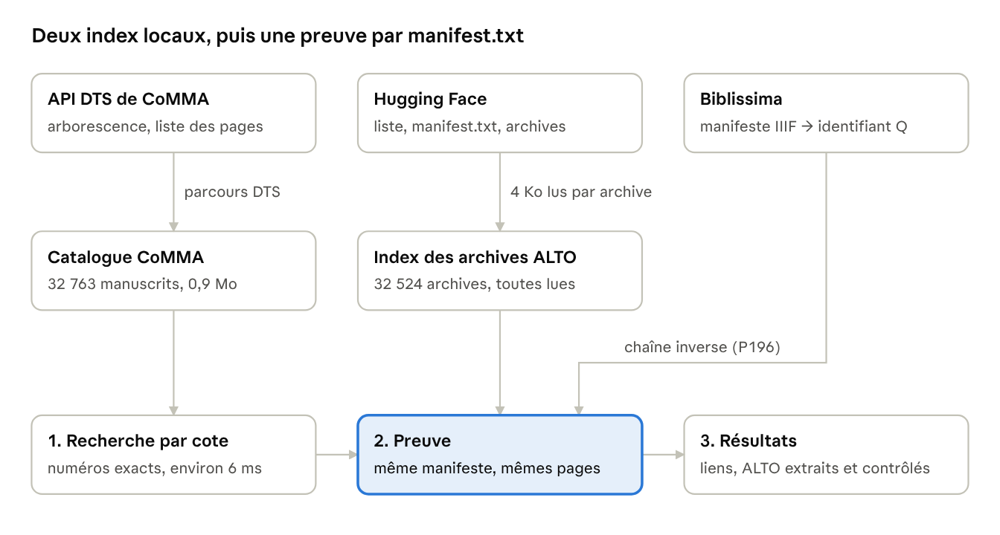

# CoMMA-Search — recherche par cote dans CoMMA et récupération des ALTO

*[English version](README.en.md)*

CoMMA-Search retrouve un manuscrit du corpus [CoMMA](https://comma.inria.fr/catalog) (Inria) par sa cote en quelques millisecondes, sans passer par la recherche du site, puis relie sa transcription à ses fichiers ALTO sur Hugging Face en **prouvant** la correspondance par le `manifest.txt` de chaque archive. Il repose sur deux index locaux, livrés tout faits et mis à jour par l'application : le catalogue CoMMA (32 763 manuscrits) et l'index des archives ALTO (32 524 archives, toutes lues).



Les deux index sont construits une fois et livrés avec l'outil ; à chaque recherche, il ne relit en direct que la ligne 1 du `manifest.txt` des archives trouvées et la liste des pages CoMMA.

## Installation et lancement

### Exécutables (sans Python)

Des exécutables prêts à l'emploi sont joints aux versions publiées (onglet **Releases**) : `CoMMA-Search-windows.zip`, `CoMMA-Search-macos.zip` (Mac Apple Silicon), `CoMMA-Search-linux.tar.gz`. Décompressez et lancez `CoMMA-Search`.

Ils ne sont pas signés :

- **Windows** : si SmartScreen affiche « Windows a protégé votre ordinateur », cliquez sur *Informations complémentaires*, puis *Exécuter quand même*.
- **macOS** : la première fois, clic droit (ou Ctrl-clic) sur `CoMMA-Search.app`, puis *Ouvrir*.

### Avec Python

Python 3.8 ou plus récent, avec Tkinter (fourni avec Python sous Windows et macOS, et avec Anaconda/Spyder ; sous Linux : paquet `python3-tk`). Aucune autre bibliothèque n'est nécessaire.

| Usage | Commande |
| --- | --- |
| Spyder | ouvrir `CoMMAsearch.py`, appuyer sur **F5** |
| Terminal | `python CoMMAsearch.py` |
| Recherche pré-remplie | `python CoMMAsearch.py --recherche "Troyes 816"` |
| Sans interface | `python CoMMAsearch.py --cli "Troyes, BM, 816"` (ajouter `--telecharger` pour télécharger et extraire l'archive confirmée) |
| Langue | `--lang fr` ou `--lang en` (sinon le réglage enregistré, puis la langue du système) |

Gardez ensemble `CoMMAsearch.py`, `comma_core.py`, `comma_i18n.py` et le dossier `donnees/`.

## Vue d'ensemble

L'outil interroge trois sources publiques, sans compte ni clé :

| Source | Ce que l'outil y prend | Point d'accès |
| --- | --- | --- |
| CoMMA, API DTS de TexTile | l'arborescence du catalogue, la liste des pages de chaque manuscrit | `comma.inria.fr/api/collection/`, `/api/navigation/` |
| Hugging Face, dépôt `comma-project/alto-dataset` | la liste des archives, le début de leur `manifest.txt`, le téléchargement | `huggingface.co/api/datasets/…/tree/main`, `…/resolve/main/` |
| Biblissima (Wikibase) | la chaîne inverse manifeste IIIF → identifiant Q | `data.biblissima.fr/w/api.php` |

Les fichiers du dépôt :

| Fichier | Rôle |
| --- | --- |
| `CoMMAsearch.py` | interface Tkinter (lancée par F5 dans Spyder) et mode texte (`--cli`) |
| `comma_core.py` | toute la logique : index, recherche, correspondances, téléchargement |
| `comma_i18n.py` | traductions français / anglais |
| `donnees/catalogue_comma.json.gz` (0,9 Mo) | catalogue CoMMA livré |
| `donnees/index_alto.json.gz` (0,8 Mo) | index des archives ALTO livré |
| `tests/test_comma_core.py` | 25 tests hors ligne : `python -m unittest discover -s tests` |
| `packaging/comma_search.spec` | construction des exécutables (PyInstaller) |
| `.github/workflows/` | `Tests` (Windows, macOS, Linux) et `Binaries` (exécutables) |

Seule la bibliothèque standard de Python est utilisée (urllib, gzip, zlib, tarfile, tkinter) : rien à installer, sous Windows, macOS et Linux.

## Index 1 : le catalogue CoMMA local

Le catalogue local contient les 32 763 manuscrits publiés par CoMMA, exactement le total annoncé par `/api/manuscripts/count/` ; il a été construit le 15/11/2026 en 3 min 43 s. L'outil ne se sert pas de la recherche plein texte du site : elle est floue (« Troyes 816 » n'y renvoie pas le ms. 816, « Latin 16400 » y renvoie d'abord 16408 et 16401) et son champ `manifest_url` peut être faux.

**Construction.** L'outil parcourt l'arborescence publique de l'API DTS, page par page :

1. la racine `mega-corpus` liste 227 villes ;
2. chaque ville liste ses établissements (405 en tout) ;
3. chaque établissement liste ses manuscrits, par pages de 20 (`/api/collection/?id=<id>&nav=children&page=<n>`) ; la dernière page est lue dans le lien `view.last`.

Cela fait environ 2 300 requêtes, six en parallèle. Une collection rattachée à deux parents n'est lue qu'une fois ; une erreur ou une fermeture de la fenêtre arrête tout le parcours en quelques instants, et le catalogue précédent est conservé.

**Contenu de chaque fiche** (tout vient de la ressource DTS du manuscrit) :

| Champ | Origine | Exemple (Troyes 816) |
| --- | --- | --- |
| identifiant | `@id` de la ressource, qui est l'URI Biblissima | `https://data.biblissima.fr/entity/Q412957` |
| intitulé | `title` | Troyes. Médiathèque du Grand Troyes, Ms. 816 |
| manifeste IIIF | `dublinCore.source` | `https://api.irht.cnrs.fr/ark:/63955/f9a5a7k98nwu/manifest.json` |
| date, langue | `dublinCore.created`, `.language` | 1201/1400 · lat |
| volume | `dublinCore.extent` | Tokens: 358200, Acceptable OCRed lines: 47108 (90.8%) |
| ville, établissement | titres des collections parentes | Troyes · Troyes. Médiathèque du Grand Troyes |

**Au chargement** (environ 1 s), l'outil prépare pour chaque fiche : les mots de l'intitulé en minuscules sans accents ; ses « clés de cote » (voir la recherche) ; la clé canonique de son manifeste IIIF (voir l'index ALTO). Il construit deux tables d'accès direct : par identifiant Q et par clé IIIF.

**Stockage et mise à jour.** Le catalogue est un JSON compressé daté (`generated`). L'outil charge la version la plus récente entre celle livrée dans `donnees/` et celle du cache utilisateur. Le menu **Index… → Mettre à jour le catalogue CoMMA** relance le parcours ; le résultat est écrit dans le cache, jamais par-dessus les données livrées.

## Index 2 : l'index des archives ALTO

L'index associe chacune des 32 524 archives du dépôt à la première ligne de son `manifest.txt`, c'est-à-dire au manifeste IIIF de la numérisation transcrite. Il a été construit le 15/11/2026 à partir du dépôt dans son état du 14/09/2026 (commit `940ed84`) : 32 524 archives lues, aucune erreur, sans télécharger les plusieurs dizaines de gigaoctets du dépôt.

**1. La liste des archives.** L'API de Hugging Face donne l'arborescence sans rien télécharger. Pour chacun des 30 dossiers (`batch_000`, `batch_007` à `batch_032`, `old-batch-subfolders`, `-0`, `-1`), l'outil demande la liste récursive (`/tree/main/<dossier>?recursive=true`), paginée par l'en-tête `Link`. Résultat : le chemin et la taille de chaque `.tar.gz`, en environ 10 secondes.

**2. La lecture partielle de `manifest.txt`.** Le premier membre de chaque archive est `manifest.txt`. L'outil demande seulement les 4 premiers kilo-octets de l'archive (en-tête HTTP `Range: bytes=0-4095`), au lieu de plusieurs mégaoctets :

1. il décompresse ce début de gzip ;
2. il lit l'en-tête tar de 512 octets : le nom du premier membre et sa taille ;
3. si c'est bien `manifest.txt`, il garde la ligne 1 (le manifeste IIIF) et la ligne 2 (le premier fichier ALTO).

Le scan complet a lu les 32 524 archives en 38 min 30 s, six en parallèle (environ 13 archives par seconde, 130 Mo transférés en tout). C'est ce résultat qui est livré dans `donnees/index_alto.json.gz`.

**3. La clé canonique du manifeste.** Les mêmes numérisations sont citées sous des URL différentes. Les archives BnF citent `openapi.bnf.fr/iiif/presentation/v3/ark:/12148/…`, alors que CoMMA et Biblissima citent `gallica.bnf.fr/iiif/ark:/12148/…`. L'outil compare donc une clé :

- pour un ARK : `ark:/<NAAN>/<nom>` en minuscules, par exemple `ark:/12148/btv1b9077719x` (BnF) ou `ark:/63955/f9a5a7k98nwu` (IRHT) ;
- sinon : hôte + chemin, sans `https://`, sans paramètres, sans `/manifest` ni `.json` final (Munich, e-codices, Oxford).

**4. Ce que contient l'index.** Pour chaque archive : chemin, taille, ligne IIIF, premier fichier ALTO, date de lecture, erreur éventuelle. Au chargement (0,5 s), l'outil construit la table inverse clé IIIF → archives : 28 642 manifestes ont une seule archive, 1 452 en ont deux et 326 en ont trois (doublons entre lots).

**5. La mise à jour.** Si la liste date de plus de 7 jours, l'outil la relit au démarrage. Il ajoute les archives nouvelles, relit celles dont la taille a changé et retire celles qui ont disparu ; seules les archives nouvelles ou modifiées sont lues. Le menu **Index…** permet de le faire à la demande. Toute lecture faite pendant une session est gardée dans le cache.

## La recherche par cote

La recherche se fait entièrement dans le catalogue local, en environ 6 ms pour les 32 763 fiches. La règle centrale : **les numéros sont exacts, les mots servent au classement**. Ainsi 816 ne renvoie ni 1816 ni 8160, mais « BM » n'exclut pas un intitulé qui dit « Médiathèque ».

**1. Identifiants reconnus directement**, avant toute analyse :

- un nom d'archive (`….tar.gz`, `batch_…`) : l'outil remonte la chaîne archive → manifeste → manuscrit ;
- une URL de manifeste IIIF ou un ARK seul : recherche par clé IIIF ;
- un identifiant `Q…`, une URL Biblissima ou une URL de transcription CoMMA (décodée deux fois) : recherche par identifiant.

**2. Normalisation de la saisie** : minuscules, accents et ligatures retirés, ponctuation remplacée par des espaces. « Châteaudun, Archives municipales, A 002 » devient `chateaudun archives municipales a 002`.

**3. Les clés de cote** (obligatoires) : chaque mot qui contient un chiffre, zéros initiaux retirés.

- `0816` → `816` ; `A 002` → `a2` (une lettre isolée devant un nombre lui est collée) ;
- `6400 G` → `6400g` (une lettre isolée après un nombre aussi, sauf à, d', l') ;
- les intitulés du catalogue sont décomposés de la même façon, avec les deux formes (séparée et collée).

Un manuscrit n'est retenu que s'il porte **toutes** les clés de la saisie.

**4. Les mots** (classement) : les mots vides sont retirés (de, du, la, ms, cote…) ; les abréviations deviennent des groupes de synonymes, dont un seul suffit.

| Saisie | Mots acceptés dans l'intitulé |
| --- | --- |
| BM | municipale, médiathèque, bibliothèque |
| BnF, BN | nationale |
| AM / AD / AN | municipales / départementales / nationales |
| lat., latin | latin |
| fr., français | français |
| NAL, NAF | NAL, NAF |

Un mot est trouvé s'il est égal à un mot de l'intitulé ou s'il en est le début (3 lettres au moins). La pertinence est la part des groupes trouvés. L'outil garde les meilleurs résultats, et, quand aucun n'a tout trouvé, ceux dont la pertinence est à moins de 0,34 du meilleur. Sans numéro, tous les mots sont exigés.

**5. Les replis.** Si aucune cote exacte n'existe, un second passage accepte les préfixes numériques et l'affiche comme « correspondance approchée ». Si le catalogue local ne trouve rien, l'outil interroge le serveur CoMMA : la ressource elle-même pour un identifiant Q, sinon sa recherche plein texte, filtrée par les clés de cote. Les résultats sont limités à 300, triés par pertinence puis dans l'ordre naturel des cotes.

**Exemples, sur le vrai catalogue** (un seul résultat à chaque fois) :

| Saisie | Clés / mots retenus | Manuscrit trouvé |
| --- | --- | --- |
| Troyes, BM, 816 | 816 · troyes, BM | Troyes, Médiathèque du Grand Troyes, Ms. 816 (Q412957) |
| Troyes 0816 | 816 · troyes | idem |
| Paris, BnF, Latin 16400 | 16400 · paris, BnF, latin | Paris, BnF, Département des manuscrits, Latin 16400 (Q61665) |
| BnF Latin 16400 | 16400 · BnF, latin | idem |
| Châteaudun A2 | a2 · chateaudun | Châteaudun, Archives municipales, Hôtel-Dieu, ms. A2 (Q419352) |
| Châteaudun, Archives municipales, A 002 | a2 · chateaudun, archives, municipales | idem |
| Troyes, BM, 1759 | 1759 · troyes, BM | Troyes, Médiathèque du Grand Troyes, Ms. 1759 (Q277651) |

## La correspondance CoMMA ↔ ALTO

Une archive n'est déclarée correspondante que si la première ligne de son `manifest.txt` désigne le même manifeste IIIF que la ressource CoMMA ; le nom de l'archive ne sert jamais de preuve. L'article CoMMA ([Clérice et al., HAL hal-05299220](https://inria.hal.science/hal-05299220), section 3.2) décrit ce manifeste personnalisé : URI du manifeste IIIF d'origine, puis liste ordonnée des fichiers ALTO.

**1. La preuve.** L'outil prend la clé IIIF de la fiche CoMMA et cherche, dans la table inverse de l'index, les archives qui ont la même clé. Il relit aussitôt la première ligne de chacune (4 Ko) pour vérifier que l'archive n'a pas changé depuis la construction de l'index.

**2. Le second contrôle, indépendant.** L'outil compare la liste des pages CoMMA (API `/navigation`) à la liste des fichiers ALTO de `manifest.txt`, lue cette fois en entier par des requêtes partielles de 64 Ko à 4 Mo. Les identifiants de pages CoMMA sont les noms des fichiers ALTO sans `.xml` : `f0-marque-de-service-debut` = `f0-marque-de-service-debut.xml`. Si les deux listes ont le même nombre d'éléments, les mêmes noms et le même ordre, l'outil l'affiche (« ✔ Les 295 pages CoMMA et les 295 fichiers ALTO… ») ; sinon il signale l'écart et plafonne la certitude à 90 %.

**3. Les candidats par le nom** (secours et mise en garde). L'outil cherche aussi les archives dont le nom évoque la cote, pour montrer les autres numérisations du même manuscrit.

- Le nom est découpé aux tirets : `france-troyes-fonds-principal-1713-integral` donne troyes, 1713, integral…
- Il doit contenir toutes les clés de la cote et tous les mots de la ville (ou commencer par `bn-f-` pour la BnF).
- Score : 0,6 + 0,3 × part des mots de l'intitulé retrouvés − 0,1 par nombre en trop dans le nom (+ 0,05 pour une archive `-integral`).
- Un candidat non lu est lu sur-le-champ. S'il cite le même manifeste, il est confirmé ; sinon c'est une autre numérisation, et l'outil indique à quel manuscrit CoMMA appartient ce manifeste.

Ce troisième volet existe parce que le nom trompe : pour Troyes 1713, l'archive `france-troyes-fonds-principal-1713-integral` est une autre numérisation (IRHT), alors que CoMMA a transcrit celle de Gallica (`mediatheque-de-troyes-champagne-metropole-ms-1713`, 818 pages = 818 fichiers ALTO).

**4. Les niveaux de certitude affichés :**

| Statut | Certitude | Condition |
| --- | --- | --- |
| CONFIRMÉE (vérifiée à l'instant) | 100 % | ligne 1 de `manifest.txt` relue en direct = manifeste de CoMMA |
| CONFIRMÉE | 98 % | même preuve, lue lors de la construction de l'index (relecture impossible) |
| PROBABLE (non vérifiée) | 70 % au plus | nom conforme, `manifest.txt` illisible |
| AUTRE NUMÉRISATION | 40 % au plus | nom conforme, `manifest.txt` citant un autre manifeste |
| AUCUNE TROUVÉE | — | rien : l'outil rappelle que ce n'est pas une preuve d'absence et donne le nombre d'archives indexées et lues |

Un écart dans le second contrôle ramène une archive confirmée à 90 % au plus. Avant de télécharger une archive non confirmée, l'outil demande confirmation.

## Liens, Biblissima, téléchargement

Chaque lien affiché est soit lu tel quel dans une source, soit construit à partir d'éléments vérifiés ; l'outil indique lequel.

**Identifiant Biblissima.** C'est l'identifiant même de la ressource dans l'API DTS de CoMMA (`@id` = `https://data.biblissima.fr/entity/Q…`) : il est lu, pas déduit. Le bouton ouvre la fiche `data.biblissima.fr/w/Item:Q…`.

**Lien vers la transcription.** L'adresse suit la route `document` de l'interface [TexTile](https://github.com/cllg-project/TexTile) (code public) : `comma.inria.fr/doc/` + l'URI Biblissima encodée deux fois + `/p/` + l'identifiant de la première page. Cette première page est lue dans l'API `/navigation`, qui confirme du même coup que la ressource existe. Pour Troyes 816 et Châteaudun A2, l'adresse obtenue est identique aux pages relevées à la main.

**Manifeste IIIF.** Lu dans `dublinCore.source` de la ressource DTS.

**La chaîne inverse** (quand on saisit un nom d'archive) :

1. l'outil lit la ligne 1 du `manifest.txt` de l'archive ;
2. il cherche cette clé IIIF dans le catalogue ;
3. il interroge Biblissima : `list=search`, espace de noms *Item* (120), `srsearch=haswbstatement:P196=<URL du manifeste>`, en essayant aussi l'URL Gallica pour un ARK BnF (P196 = manifeste IIIF, P195 = cote, P194 = établissement) ;
4. pour chaque Q trouvé, il prend la fiche du catalogue, ou à défaut interroge l'API DTS ; si CoMMA utilise un autre manifeste pour ce Q, il le signale.

Exemple vérifié : `api.irht.cnrs.fr/ark:/63955/fdy27ubqm4j0/manifest.json` → Q419352 → Châteaudun A2 dans CoMMA.

**Téléchargement et extraction.**

1. L'archive est téléchargée depuis `huggingface.co/datasets/comma-project/alto-dataset/resolve/main/<chemin>` dans un fichier `.part` propre à ce téléchargement, avec trois tentatives et un contrôle de la taille.
2. Elle est extraite dans `<destination>/<nom de l'archive>/`, sans liens symboliques ni chemins qui sortiraient du dossier.
3. L'outil vérifie que chaque fichier annoncé par `manifest.txt` est présent (Châteaudun A2 : 18 sur 18).
4. Il écrit `provenance_comma.json` : cote, intitulé, URI Biblissima, manifeste IIIF, lien de transcription, archive, statut de la correspondance et certitude, date, bilan du contrôle.

L'archive `.tar.gz` est gardée à côté du dossier. La destination par défaut est `~/Downloads/CoMMA_ALTO/` ; elle est modifiable et mémorisée.

**Recherche approfondie** (bouton) : l'outil relit la liste Hugging Face, lit les `manifest.txt` encore inconnus, relit toutes les archives dont le nom contient la ville du manuscrit (pour les noms inattendus) et interroge Biblissima sur le manifeste.

## Robustesse, cache, langues et limites

**Cache et réglages.** Le catalogue et l'index mis à jour, les réglages (`reglages.json` : langue, dossier de destination) et le journal des erreurs sont rangés dans `%LOCALAPPDATA%\CommaRecherche` (Windows), `~/Library/Caches/CommaRecherche` (macOS) ou `~/.cache/comma-recherche` (Linux). Les écritures sont atomiques : fichier temporaire unique, puis remplacement, avec nouvelles tentatives si un antivirus tient le fichier.

**Fonctionnement en arrière-plan.** Toute opération réseau tourne dans un fil secondaire qui ne touche jamais à la fenêtre : il communique par une file de messages, lue toutes les 120 ms. À la fermeture, les tâches s'arrêtent entre deux requêtes (moins d'une seconde en pratique) et le nettoyage se fait dans le fil principal, ce qui évite les plantages de Tkinter dans Spyder. Une recherche plus récente annule l'affichage des résultats périmés ; une courte attente après chaque clic évite une rafale de vérifications.

**Réseau.** Nouvelles tentatives sur les erreurs passagères (429, 5xx, coupures, réponses tronquées) en respectant `Retry-After` ; aucune nouvelle tentative sur un certificat invalide ou un nom d'hôte inconnu. Les lectures partielles sont plafonnées, même si un proxy ignore l'en-tête `Range`.

**Journal des erreurs.** Toute erreur est ajoutée à `journal_erreurs.txt` (menu **Index… → Ouvrir le journal des erreurs**), y compris un plantage brutal grâce au module `faulthandler`. En cas de plantage, c'est ce fichier qu'il faut envoyer.

**Langues.** Interface en français ou en anglais (menu **Langue / Language**), changement immédiat sans perdre la recherche, choix mémorisé ; au premier lancement, la langue du système. Un test vérifie que chaque texte a sa traduction.

**Conseils.**

- Sous **macOS avec Spyder**, Tkinter cohabite mal avec la boucle Qt du noyau : réglez *Préférences → Console IPython → Graphiques → Backend* sur **« En ligne » (Inline)**, ou lancez l'application dans un terminal.
- Sous **Windows**, si l'extraction échoue pour des chemins trop longs, choisissez un dossier de destination court (par exemple `C:\ALTO`).

**Limites connues.**

- L'outil vérifie la ressource et sa première page par l'API ; il ne vérifie pas l'affichage de la page dans le navigateur.
- Les index livrés datent du 15/11/2026 ; une archive publiée depuis n'est confirmée qu'après la mise à jour hebdomadaire ou une recherche approfondie.
- Les candidats par le nom sont heuristiques : ils servent à signaler, jamais à confirmer.
- Au 15/11/2026, 23 233 des 32 763 manuscrits CoMMA (70,9 %) ont une archive ALTO prouvée ; pour les 9 530 autres, aucune archive publiée ne cite leur manifeste IIIF (par exemple Troyes, ms. 1759). « AUCUNE TROUVÉE » est alors le résultat attendu.
- Le fichier `counts.json` du backend TexTile n'est pas public et n'est pas utilisé. Le dépôt `comma-jsonl` (environ 27 Go) contient cote, Q et manifeste mais pas le nom des archives : il n'est pas nécessaire.
- L'interface a été testée sous Linux (écran virtuel). Les exécutables Windows et macOS sont construits automatiquement par GitHub Actions, après les tests, mais n'ont pas encore été essayés à la main.

## Construire les exécutables

Ils sont construits par le workflow **Binaries** (`.github/workflows/binaries.yml`), à la demande (onglet *Actions*) ou à chaque étiquette `v*`, qui les joint alors à une version publiée. Pour en construire un soi-même :

```bash
pip install pyinstaller certifi
```

```bash
pyinstaller --noconfirm --clean packaging/comma_search.spec
```

## Données

Les index de `donnees/` sont dérivés des métadonnées publiques de CoMMA (Inria) et du dépôt `comma-project/alto-dataset`, publiés sous licence CC BY 4.0.
